# Guía de armado de ArchiLector v2.2 (alternativa B, rodillos)

Esta guía lleva del **robot sin armar** al **primer volteo verificado por la IA**. Sigue el
*Documento Técnico de Armado y Comunicación v2.2*: cada paso cita su sección (por ejemplo «Técnico 5.4»)
y cada prueba lleva su código (T1.1, TC.3…), para anotarla en la hoja de registro.

Lo que el Documento Técnico no especifica (torre, viga, caja de electrónica, fijación de los brazos,
travesaño de los dedos, disposición de la placa) aparece marcado como **propuesta**: el equipo puede cambiarlo.

## Esquemas

| # | Esquema | Para qué sirve |
|---|---|---|
| 01 | [Vista general](svg/01-vista-general.svg) | Dónde va cada bloque sobre la base |
| 02 | [Alimentación](svg/02-alimentacion.svg) | Fuentes, fusible, bornera, tierra única |
| 03 | [Conexionado del ESP32](svg/03-esp32-conexionado.svg) | Cada pin GPIO y su destino |
| 04 | [Circuitos auxiliares](svg/04-circuitos-auxiliares.svg) | LED con MOSFET, buzzer, teclado, I2C |
| 05 | [Placa de control](svg/05-placa-control.svg) | Disposición en la placa perforada de 7 × 9 cm |
| 06 | [Mecanismo, vista frontal](svg/06-mecanismo-frontal.svg) | Ángulos del brazo, alturas y piezas |
| 07 | [Mecanismo, vista superior](svg/07-mecanismo-superior.svg) | Posiciones a lo largo del eje |
| 08 | [Eje del rodillo](svg/08-eje-rodillo.svg) | Rodillos Canon sobre la varilla M8 |
| 09 | [Torre y cámara](svg/09-camara-torre.svg) | Altura de 350 mm, campo de visión, LED |
| 10 | [Interconexión](svg/10-interconexion.svg) | Cables C01 a C20 |
| 11 | [Secuencia de volteo](svg/11-secuencia-volteo.svg) | Qué hace cada parámetro de calibración |
| 12 | [Orden de armado](svg/12-orden-armado.svg) | Fases, pruebas y decisión final |

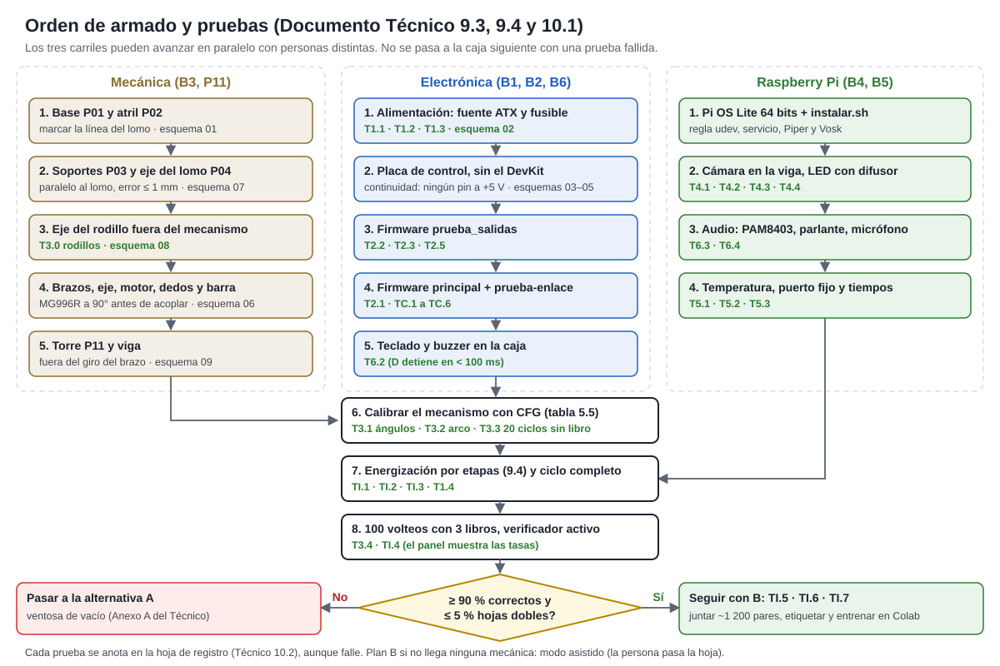

---

## 1. Lista de compras y materiales

Estado según la tabla 2 del Documento de Diseño: **D** = disponible en el inventario, **C** = comprar,
**Y** = ya comprado.

### Electrónica

| Componente | Cant. | Estado | Uso |
|---|---|---|---|
| Raspberry Pi 4 Model B (2 GB) + fuente oficial USB-C 5,1 V 3 A + case | 1 | D | Visión, OCR, IA, voz, panel web |
| microSD 32 GB clase A1 | 1 | C si no hay | Raspberry Pi OS Lite de 64 bits |
| Disipadores + ventilador de 30 mm para la Pi | 1 | C | Prueba T5.1 (bajo 80 °C) |
| Cámara oficial V1.3 + cinta CSI de 15 cm | 1 | D | Foto de la página |
| ESP32 DevKit (ESP32-WROOM-32) | 1 | D (2 en el kit) | Tiempo real del volteo |
| Motor 28BYJ-48 + módulo ULN2003 | 1 | D | Girar los rodillos |
| Servo MG996R (con bocina metálica) | 1 | C | Girar los brazos |
| Servo SG90 | 2 | 1 D + 1 C | Barra de retención (el otro queda de repuesto) |
| Teclado 4×4 de membrana | 1 | D | Botones |
| LCD 16×2 con mochila I2C PCF8574 | 1 | D | Estado |
| Buzzer activo de 5 V | 1 | D | Alarmas |
| Módulo convertidor de nivel BSS138 (4 canales) | 1 | C | I2C 3,3 V ↔ 5 V |
| MOSFET IRLZ44N | 1 | C | Tira LED |
| Transistor 2N2222 + diodo 1N4148 | 1 + 1 | C | Buzzer |
| Resistencias 1/4 W: 100 Ω, 1 kΩ, 100 kΩ y 4 × 10 kΩ | 7 | C | Circuitos auxiliares |
| Placa perforada 7 × 9 cm + 2 tiras de zócalo hembra | 1 | C | Placa de control |
| Conectores macho: 2 × 3 pines, 6, 4 y 8 pines; 3 borneras de tornillo de 2 vías | — | C | Conexiones de la placa |
| Tira LED blanca de 5 V + difusor | ~40 cm | C | Iluminación uniforme |
| Micrófono USB | 1 | C | Comandos por voz |
| Amplificador PAM8403 + parlante 4–8 Ω 3 W + potenciómetro de volumen | 1 | C | Lectura en voz alta |
| Cable USB A a micro USB **con datos**, ≤ 1 m | 1 | C | Pi ↔ ESP32 (C16) |

### Alimentación (Técnico 3.4)

| Componente | Cant. | Uso |
|---|---|---|
| Fuente conmutada 5 V 3 A, plug 5,5 × 2,1 mm | 1 | Rama de actuadores |
| Jack hembra de panel 5,5 × 2,1 mm | 1 | Entrada de la fuente |
| Interruptor de palanca | 1 | Corta solo los actuadores |
| Portafusible + fusible de 4 A | 1 | En serie con +5 V |
| Bornera de barra de 2 filas × 6 posiciones | 1 | +5 V y GND |
| Capacitor electrolítico 2200 µF, ≥ 10 V | 1 | Transitorios de los servos |
| Cable AWG 18 rojo y negro (1 m) y AWG 20–22 en colores (3 m) | — | Fuente y ramales |
| Resistencia de 2,2 Ω 15 W | 1 | Solo para la prueba T1.3 |
| Medidor USB-C de tensión y corriente | 1 | Solo para pruebas |

### Mecánica (Técnico tabla 5.1)

| Pieza | Descripción | Material y medida | Cant. |
|---|---|---|---|
| P01 | Base | MDF 9 mm, 500 × 380 mm | 1 |
| P02 | Atril con topes laterales | MDF 5 mm, 320 × 240 mm, topes de 10 mm | 1 |
| P03 | Soportes del eje (delantero y trasero) con ranura de altura | MDF 9 mm o impresión 3D; eje a ~15 mm sobre la página | 2 |
| P04 | Eje del lomo | Varilla de acero de 8 mm × 300 mm + 2 rodamientos 608ZZ | 1 |
| P05 | Brazos | Acrílico 3 mm; 120 mm del eje al rodillo; alojamiento de 22 mm para el 608ZZ | 2 |
| P06 | Rodillos Canon FB6-3405-000 (**Y**) | Agujero de 8 mm; medir diámetro, largo y peso | 2 |
| P07 | Acople flexible | 5 × 8 mm | 1 |
| P08 | Dedos de arrastre | Lámina de PET 0,3 mm, 40 × 15 mm | 2 |
| P09 | Servo de giro | MG996R (ver Electrónica) | 1 |
| P10 | Barra de retención | Varilla de aluminio 6 mm × 260 mm | 1 |
| P11 | Torre y viga de la cámara | **Propuesta:** listón de 30 × 30 mm o perfil de aluminio, ~450 mm de alto; viga de ~260 mm con ranura | 1 |
| P12 | Eje del rodillo | Varilla roscada M8 de acero cincado, 270 mm | 1 |
| P13 | Fijación | Tuercas M8 + arandelas M8 | 8 + 8 |
| P14 | Rodamientos del eje del rodillo | 608ZZ (8 × 22 × 7 mm) | 2 |

En total son **4 rodamientos 608ZZ**: 2 en los soportes P03 y 2 en los brazos P05.

**Propuestas de tornillería** (el Documento Técnico no las detalla): 2 collarines de 8 mm con prisionero
para fijar cada brazo al eje del lomo; un travesaño entre los brazos (tira de acrílico o varilla de 4 mm)
para pegar los dedos P08; una escuadra para el motor en el brazo trasero; tornillos M2 para la cámara,
separadores M2,5 para la Pi, precintos y etiquetas para los cables; una caja de electrónica de unos
80 × 145 mm de planta.

### Herramientas

Soldador y estaño, multímetro, pelacables, taladro con brocas de 3, 8 y 22 mm (o broca escalonada
para el alojamiento del 608ZZ), caladora o sierra para MDF, 2 llaves de 13 mm (tuercas M8),
destornilladores, calibre (pie de rey), nivel de burbuja, escuadra, pistola de silicona y cinta doble faz.

---

## 2. Antes de empezar: seguridad y colores (Técnico 1.3 y 1.4)

1. **Ningún motor ni servo** se alimenta desde los pines de 5 V o 3,3 V del ESP32 o de la Pi.
2. **Una sola tierra:** todas las tierras se unen en la fila GND de la bornera.
3. Se conecta y desconecta todo **con la alimentación apagada**.
4. **Ninguna señal de 5 V entra a un pin del ESP32** (sus pines no toleran 5 V).

| Color | Uso |
|---|---|
| Rojo | +5 V |
| Naranja | +3,3 V |
| Negro | GND |
| Amarillo | PWM de los servos |
| Azul / verde | I2C: SDA azul, SCL verde |
| Blanco | Otras señales (motor, teclado, buzzer) |

Etiquete cada cable en ambos extremos con su código (C01 a C20, [esquema 10](svg/10-interconexion.svg)).

---

## 3. Carril A · Mecánica

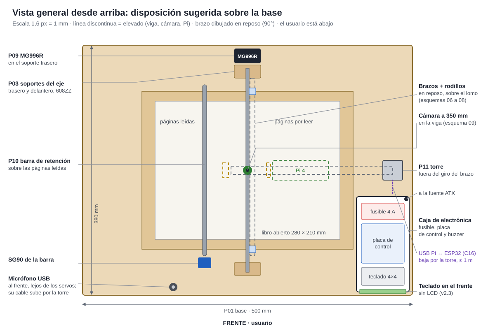

### A1. Base y atril (P01, P02)
1. Cortar la base de 500 × 380 mm y el atril de 320 × 240 mm.
2. Pegar los topes laterales de 10 mm al atril y fijarlo a la base.
3. Marcar en el atril **la línea del lomo**: debe quedar justo debajo del eje del lomo.

### A2. Soportes y eje del lomo (P03, P04)

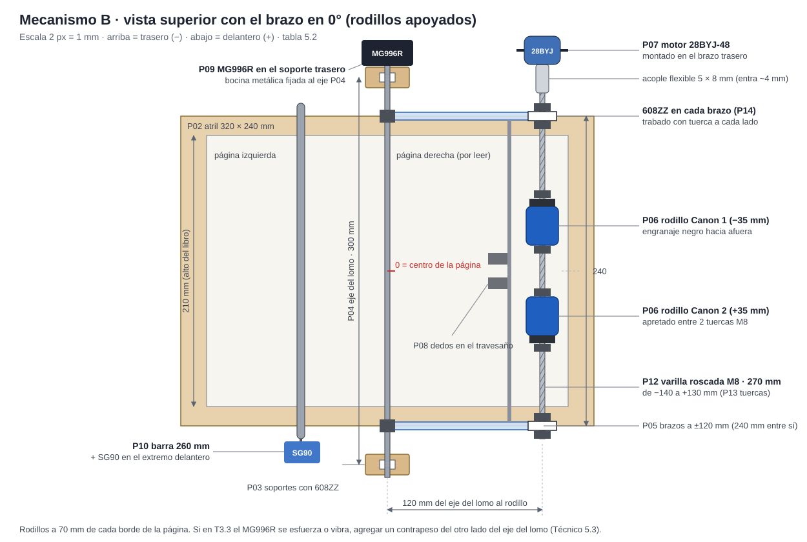

1. Hacer los dos soportes P03 con el alojamiento de 22 mm para el 608ZZ y una **ranura de altura**
   (el eje queda a unos 15 mm sobre la página).
2. Montar los soportes a 150 mm a cada lado del centro de la página (300 mm entre sí), fuera del atril.
3. Insertar el eje P04. Debe girar libre y quedar **paralelo a la línea del lomo con un error de 1 mm o menos**.
4. Fijar los brazos P05 al eje con prisioneros, **separados 240 mm** (a ±120 mm del centro), y
   presionar un 608ZZ (P14) en el alojamiento de cada brazo.

### A3. Eje del rodillo, fuera del mecanismo (P06, P12, P13)

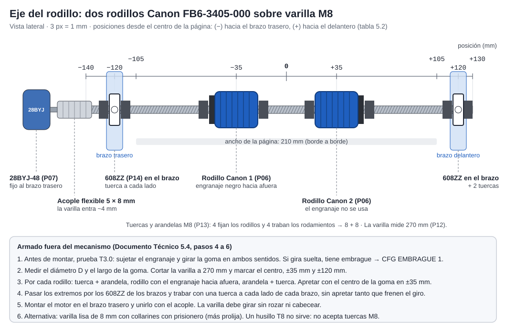

1. **Prueba T3.0:** sujetar el engranaje de cada rodillo y girar la goma en ambos sentidos.
   Si gira suelta en algún sentido, tiene embrague: anotarlo; después se configura `CFG EMBRAGUE 1`
   y el comando BACK queda deshabilitado.
2. Medir con el calibre **el diámetro D y el largo de la goma**, y pesar los rodillos. Anotarlos: D sirve
   para calcular `PASOS_ARCO` y el peso, para revisar el torque del MG996R.
3. Cortar la varilla M8 a 270 mm y marcar el centro, ±35 mm y ±120 mm.
4. Montar cada rodillo entre dos tuercas con arandela, **con el engranaje hacia afuera**, con el centro
   de la goma en ±35 mm (a 70 mm de cada borde de la página).

### A4. Brazo completo, motor, dedos y barra (P05 a P10)

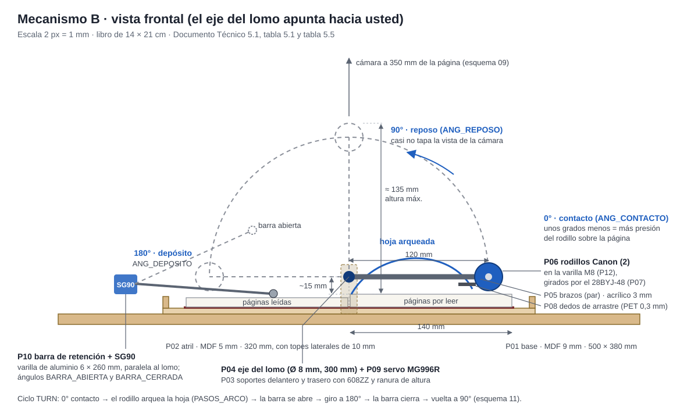

1. Pasar los extremos de la varilla por los 608ZZ de los brazos y trabarla con una tuerca a cada lado
   de cada brazo, **sin apretar tanto que frenen el giro**.
2. Montar el 28BYJ-48 en el brazo trasero y unirlo a la varilla con el acople de 5 × 8 mm
   (la varilla entra unos 4 mm). La varilla debe girar sin rozar ni cabecear.
3. Pegar los dedos de arrastre P08 al travesaño, rozando apenas la página.
4. **No acoplar todavía el MG996R al eje.** Primero se lleva a 90° con el ESP32 (paso E5); recién
   entonces, con el brazo vertical, se acopla la bocina al eje.
5. Montar la barra P10 con el SG90 en posición «cerrada» sobre las páginas leídas.
6. Pasar el cable del motor por el brazo con un **bucle de holgura** que permita los 180° de giro sin tirar.

**Torque (Técnico 5.3):** el conjunto que gira pesa unos 260 g y da unos 3 kg·cm frente a los ~9 kg·cm
del MG996R. Si en T3.3 el servo se esfuerza o vibra, agregar un contrapeso del otro lado del eje del lomo.

### A5. Torre y viga (P11)

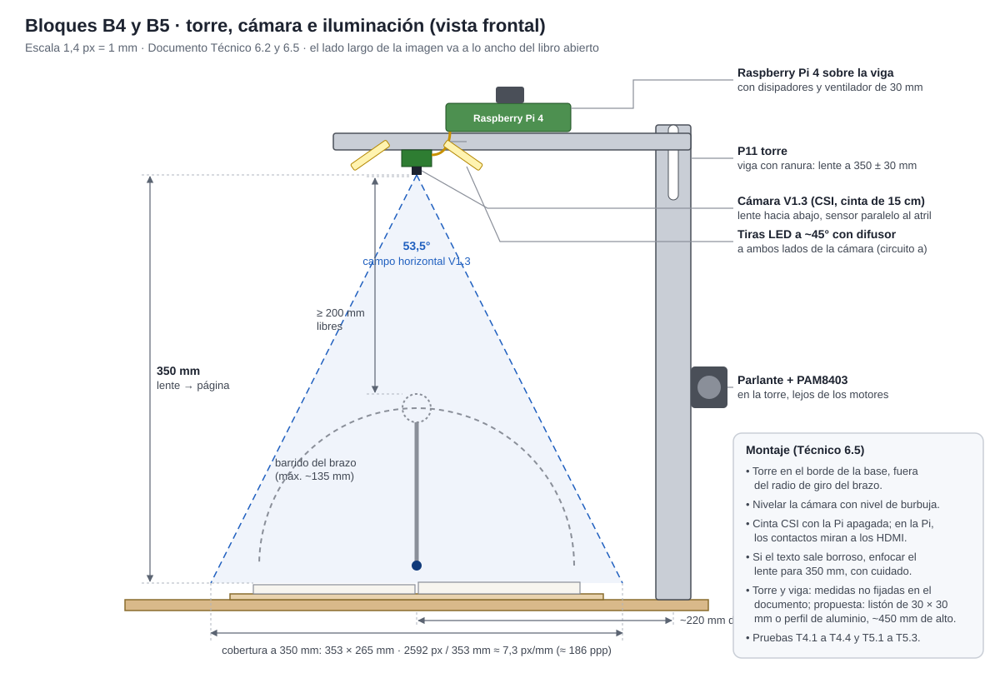

1. Montar la torre en el borde de la base, **fuera del radio de giro del brazo** (~135 mm desde el lomo).
   Propuesta: a unos 220 mm del lomo, del lado derecho.
2. Fijar la viga de modo que el lente quede **a 350 mm de la página**, con una ranura de ±30 mm.

---

## 4. Carril B · Electrónica

### B1. Alimentación (Técnico 3.5)

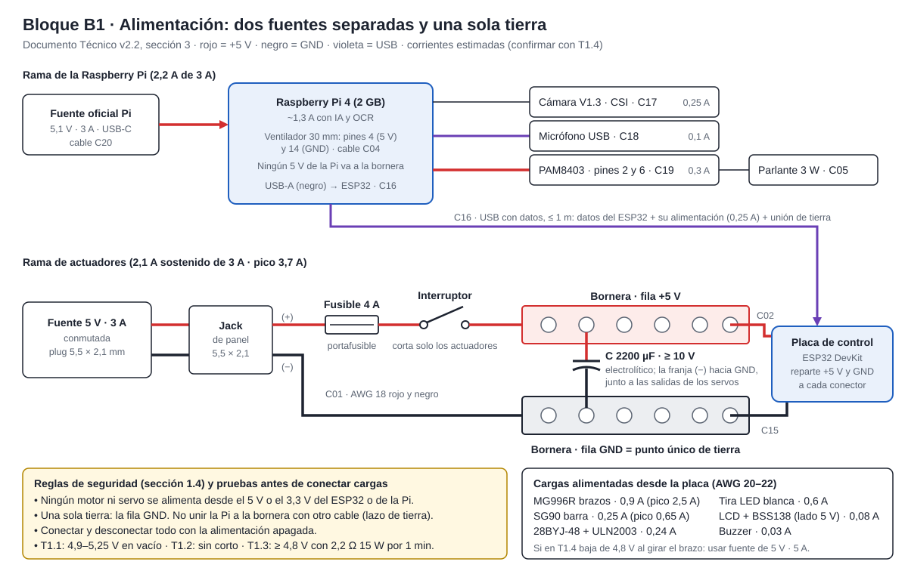

1. Montar el jack, el interruptor y el portafusible en una pared de la caja de electrónica.
2. **C01** con AWG 18 rojo: (+) del jack → fusible → interruptor → fila +5 V de la bornera.
   Con AWG 18 negro: (−) del jack → fila GND.
3. Soldar o atornillar el capacitor de 2200 µF entre +5 V y GND en la bornera, **con la franja hacia GND**.
4. Hacer las pruebas **antes de conectar cualquier carga**:

| Prueba | Procedimiento | Pasa si |
|---|---|---|
| T1.1 Tensión en vacío | Multímetro entre +5 V y GND de la bornera | 4,9 a 5,25 V |
| T1.2 Aislamiento | Fuente desconectada, continuidad entre +5 V y GND | Sin cortocircuito |
| T1.3 Carga | Resistencia de 2,2 Ω 15 W durante 1 min | ≥ 4,8 V y la fuente no se calienta en exceso |

5. La Pi se conecta **solo a su fuente oficial**. Ningún pin de 5 V de la Pi se une a la bornera.

### B2. Placa de control (Técnico 4.4 y 4.5)

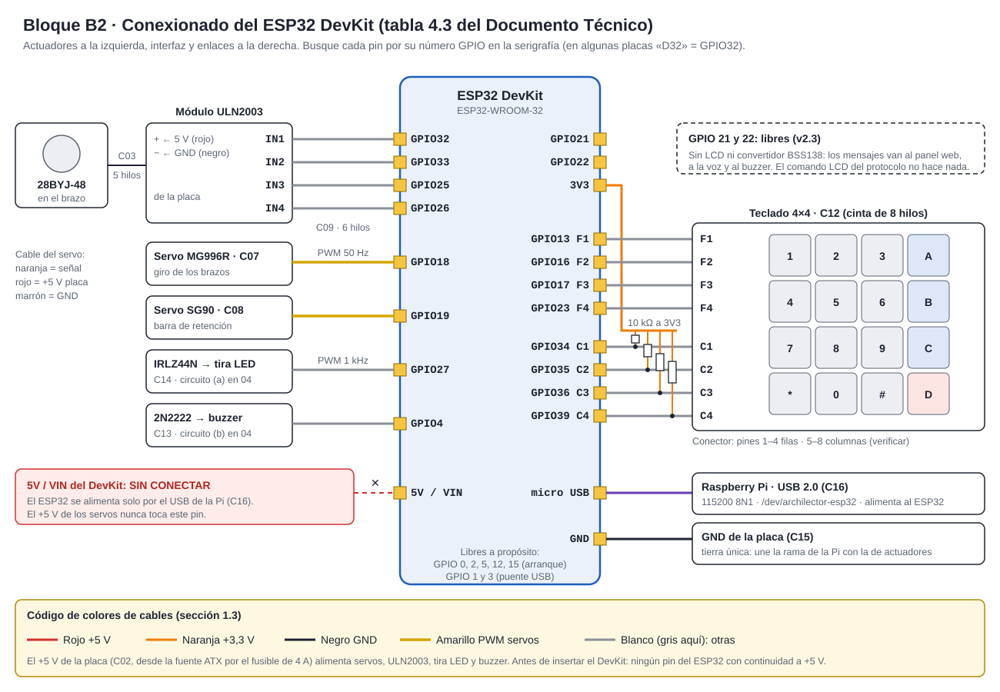

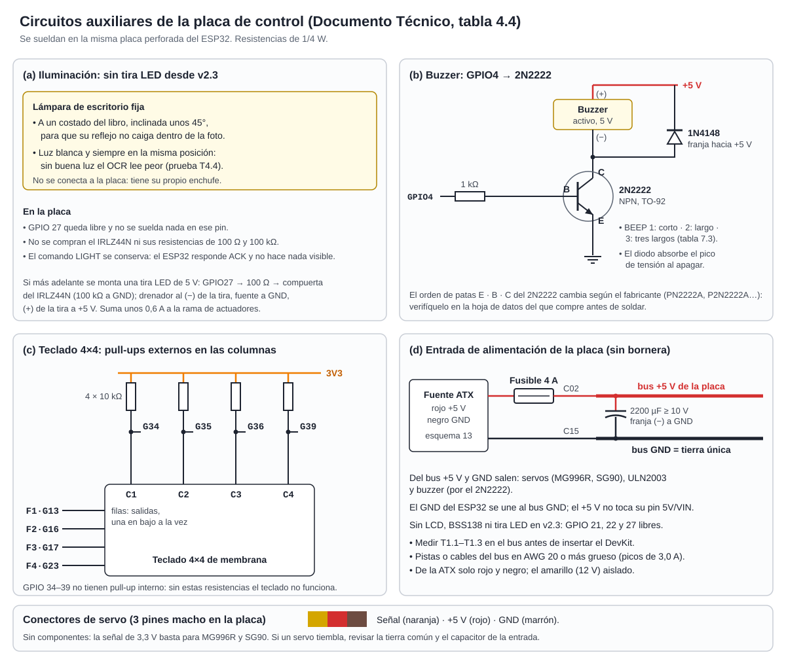

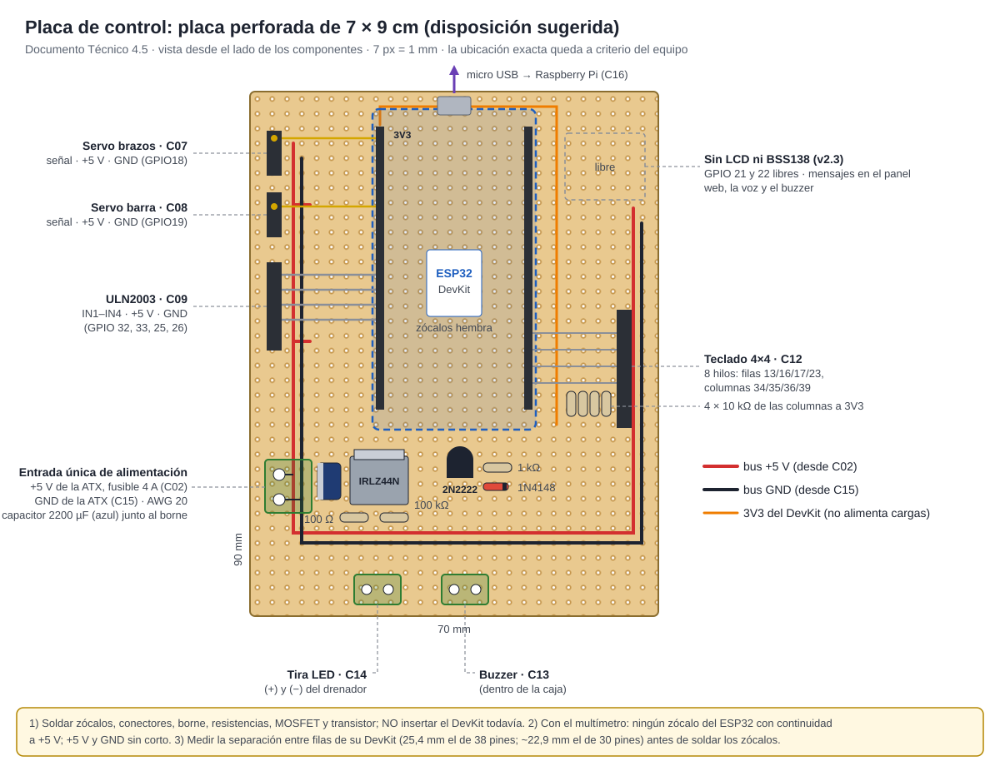

1. Medir la separación entre las filas de pines de **su** DevKit y soldar las dos tiras de zócalo hembra.
2. Soldar las 4 resistencias de 10 kΩ del teclado, el IRLZ44N con sus resistencias de 100 Ω y 100 kΩ,
   el 2N2222 con su resistencia de 1 kΩ y el 1N4148, y los conectores de 3 pines de los servos.
3. Llevar a la placa **una sola entrada** de +5 V (C02) y GND (C15) desde la bornera; de ahí se alimentan
   los servos, el LED, el buzzer, el ULN2003 y el lado de 5 V del BSS138. El 5 V **no toca el pin
   5V/VIN** del DevKit.
4. Cablear los GPIO según el esquema 03 y el código de colores.
5. Instalar el BSS138 junto al conector de la LCD.
6. **Con el multímetro: ningún zócalo del ESP32 con continuidad a +5 V.**
7. Insertar el DevKit y conectarlo solo por USB.

### B3. Firmware de prueba (T2.2 a T2.5)

Desde un PC con PlatformIO (o VS Code con la extensión PlatformIO):

```bash
cd firmware/esp32
pio run -e prueba_salidas -t upload
pio device monitor
```

| Prueba | Pasa si |
|---|---|
| T2.2 Arranque limpio | Al reiniciar, ningún servo salta ni se encienden el LED o el buzzer |
| T2.3 Salidas | Cada GPIO cambia de estado y el motor gira en ambos sentidos |
| T2.4 I2C | El escaneo muestra la LCD en 0x27 (o 0x3F) |
| T2.5 Teclado | Las 16 teclas se leen una vez cada una, sin rebotes |

Si el motor solo vibra, el orden de fases IN1–IN4 está cambiado: intercambiar los cables de GPIO 33 y 25.

### B4. Firmware principal y pruebas de comunicación (T2.1, TC.1 a TC.6)

```bash
pio run -t upload
```

Con el ESP32 conectado a la Pi (o a un PC) y el software instalado:

```bash
cd pi
.venv/bin/python -m archilector prueba-enlace
```

El comando ejecuta T2.1 (PONG en menos de 50 ms) y TC.1 a TC.6, e imprime «Pasa» o «FALLA» para cada una.
TC.2, TC.3 y TC.5 **mueven el mecanismo**. TC.4 es manual: desconecte el USB en reposo y, en 5 s,
la LCD debe mostrar «SIN ENLACE».

### B5. Interfaz (Técnico 7.5)

1. Montar la LCD y el teclado en el frente de la caja, y el buzzer dentro, frente a un agujero de 5 mm.
2. Conectar la LCD al lado de 5 V del BSS138 (C11) y el teclado a la placa con su cinta (C12), filas primero.
3. Ajustar el contraste con el potenciómetro de la mochila PCF8574.
4. **T6.1:** los textos de la LCD se leen completos. **T6.2:** con el brazo girando, la tecla **D** lo
   detiene en menos de 100 ms, aunque la Pi esté desconectada.

---

## 5. Carril C · Raspberry Pi, cámara y audio

1. Grabar **Raspberry Pi OS Lite de 64 bits** en la microSD, activar SSH y conectar la Pi a la red.
2. Clonar el repositorio e instalar:

   ```bash
   git clone https://github.com/fermelli/archilector.git ~/ArchiLector
   cd ~/ArchiLector/pi
   bash deploy/instalar.sh
   ```

   El instalador configura zram, el entorno de Python, Piper y Vosk en español, la regla udev
   (`/dev/archilector-esp32`) y el servicio.
3. Montar la Pi sobre la viga, junto a la cámara, y conectar la cinta CSI **con la Pi apagada**
   (en la Pi, los contactos de la cinta miran hacia los HDMI).
4. Atornillar la cámara con el lente hacia abajo y nivelarla con un nivel de burbuja.
5. Pegar las tiras LED bajo la viga, a ambos lados de la cámara, **inclinadas unos 45°** y con difusor.

| Prueba | Cómo | Pasa si |
|---|---|---|
| T4.1 Captura | `rpicam-still -o prueba.jpg --width 2592 --height 1944` | Se guarda sin errores |
| T4.2 Encuadre | Foto del libro abierto | Ambas páginas con ≥ 10 mm de margen |
| T4.3 Nitidez | Texto de 10 pt al 100 % de zoom | Legible; si no, enfocar el lente para 350 mm |
| T4.4 Reflejos | LED al 100 % con papel satinado | Sin zonas blancas sobre el texto |
| T5.1 Temperatura | 30 min de ciclo con IA y OCR | Bajo 80 °C (`vcgencmd measure_temp`) |
| T5.2 Puerto fijo | Desconectar y reconectar el ESP32 | Reaparece `/dev/archilector-esp32` |
| T6.3 Audio | Leer una página | Voz clara al 70 %, sin zumbido de motores |
| T6.4 Micrófono | Decir «continuar» con los servos moviéndose | Se reconoce 8 de 10 veces |

Si `/dev/archilector-esp32` no aparece, ejecutar `lsusb`, anotar el VID:PID del puente USB del DevKit
y agregarlo a `deploy/99-archilector.rules`.

---

## 6. Integración (Técnico 9.3 a 9.5)

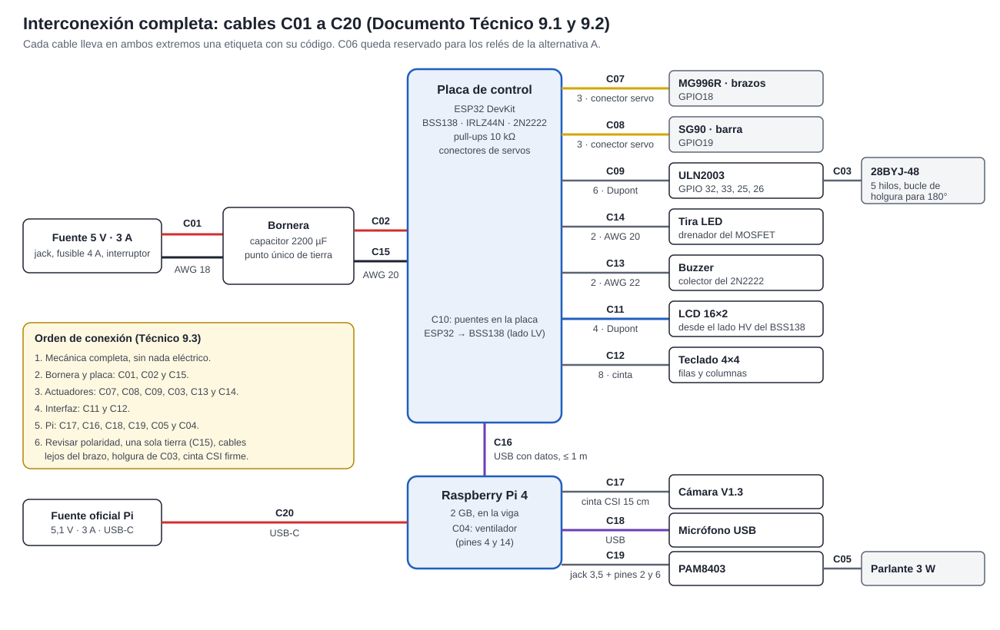

### Revisión antes de energizar
- Polaridad de C01 y C02.
- Ningún +5 V en un pin del ESP32.
- Una sola unión de tierra (C15); **ningún** cable de tierra extra entre la Pi y la bornera.
- Cables lejos del recorrido del brazo; bucle de holgura en C03; cinta CSI firme.

### Energización por etapas

| Etapa | Qué se enciende | Qué se verifica |
|---|---|---|
| 1 | Solo la Pi (interruptor de actuadores apagado) | Arranca, aparece `/dev/archilector-esp32` y el ESP32 responde PONG |
| 2 | Interruptor de actuadores | El ESP32 pasa de ARRANQUE a REPOSO; los servos llegan a reposo sin saltos |
| 3 | HOME y luego TURN, sin libro | Responde DONE y el brazo vuelve a 90° |
| 4 | Ciclo completo con libro | Foto, volteo, verificación y lectura en voz alta |

Para la etapa 3 se puede usar la consola (`python -m archilector consola`, y escribir `HOME` y `TURN`)
o el panel web: **http://&lt;pi&gt;.local:8000 → Calibración**.

### E5. Acoplar el MG996R
Con el ESP32 en REPOSO (brazo comandado a 90°), acoplar la bocina metálica del MG996R al eje del lomo
**con el brazo vertical**.

---

## 7. Calibración (Técnico 5.5)

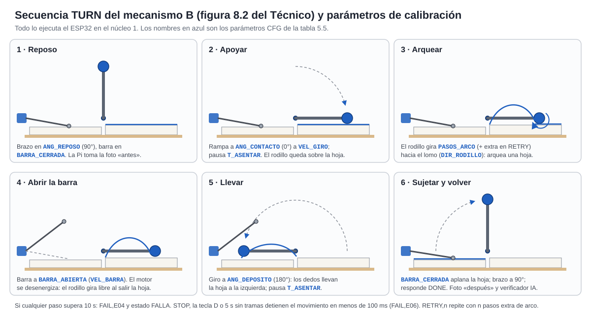

Los parámetros se cambian con `CFG` desde **Panel web → Calibración** o desde la consola
(`CFG PASOS_ARCO 1100`). Quedan guardados en el ESP32.

| Parámetro | Qué ajusta | Valor inicial | Cómo se ajusta |
|---|---|---|---|
| `ANG_REPOSO` | Brazo vertical | 90 | T3.1: vertical ±3° |
| `ANG_CONTACTO` | Rodillo sobre la página derecha | 0 | T3.1: apoya sin levantar el brazo; unos grados menos = más presión |
| `ANG_DEPOSITO` | Brazo sobre la página izquierda | 180 | T3.1 |
| `BARRA_ABIERTA` / `BARRA_CERRADA` | Ángulos del SG90 | 70 / 0 | T3.1: cerrada sobre la página |
| `PASOS_ARCO` | Pasos para arquear la hoja | 1040 | avance × 4096 / (π × D); T3.2: una sola hoja, arco ≥ 10 mm |
| `DIR_RODILLO` | Sentido «hacia el lomo» | 1 | Si arquea hacia afuera: −1 |
| `VEL_GIRO` | Rampa del MG996R (°/s) | 120 | T3.3: sin trabas ni zumbido |
| `VEL_BARRA` | Rampa del SG90 (°/s) | 180 | — |
| `VEL_RODILLO` | Pasos por segundo | 600 | Si el motor pierde pasos, bajar |
| `T_ASENTAR` | Pausa al apoyar y depositar (ms) | 250 | — |
| `EMBRAGUE` | Rodillos con embrague | 0 | Resultado de T3.0 |
| `PULSO_MIN` / `PULSO_MAX` | Pulsos para 0° y 180° (µs) | 500 / 2500 | Si el servo no llega a 0° o 180° |

Ejemplo: con D = 24 mm y un avance de 20 mm, `PASOS_ARCO` = 20 × 4096 / (3,1416 × 24) ≈ 1086.

Además, en `pi/config.yaml`, ajustar `vision.region_canto` para que el recorte del canto caiga sobre las
hojas pasadas en la foto. Antes de un libro nuevo, hacer **tres aperturas de preacondicionamiento**.

| Prueba | Procedimiento | Pasa si |
|---|---|---|
| T3.1 Ángulos | Llevar brazo y barra a cada posición | Reposo vertical ±3°; contacto sin levantar el brazo |
| T3.2 Arco | Libro de prueba, el rodillo da PASOS_ARCO | Una sola hoja, arco ≥ 10 mm |
| T3.3 Barrido | 20 ciclos TURN sin libro | Sin trabas; el servo no zumba en reposo; el cable no se tensa |
| T3.4 Confiabilidad | 100 volteos con el libro de prueba | ≥ 90 % correctos y ≤ 5 % hojas dobles |

**Decisión (Diseño 2.4.5):** si tras la calibración T3.4 no cumple, se pasa a la alternativa A
(ventosa, Anexo A del Técnico). El panel web muestra las tasas en la página de estado.

---

## 8. Hoja de registro (Técnico 10.2)

Una fila por prueba, aunque falle. Una prueba repetida es una fila nueva.

| ID | Fecha | Versión del documento | Firmware y protocolo | Resultado | Valor medido | Responsable | Observaciones |
|---|---|---|---|---|---|---|---|
| T1.1 | | 2.2 | — | Pasa / Falla | ___ V | | |
| T3.0 | | 2.2 | — | Pasa / Falla | D = ___ mm, embrague sí/no | | |
| TC.2 | | 2.2 | fw ___ · P1 | Pasa / Falla | ___ volteos | | |

---

## 9. Problemas frecuentes

| Síntoma | Causa probable | Qué hacer |
|---|---|---|
| La LCD enciende pero no muestra texto | Contraste o dirección | Girar el potenciómetro de la mochila; revisar T2.4 (0x27 o 0x3F) |
| Teclas fantasma o que no responden | Faltan las pull-ups de 10 kΩ | Revisar el circuito (c) del esquema 04 |
| Un servo tiembla | Señal de 3,3 V débil o caída de tensión | Pasar su señal por un canal libre del BSS138; revisar el capacitor |
| La Pi avisa subtensión o se reinicia | Carga en la rama de la Pi | Solo su fuente oficial; `vcgencmd get_throttled` debe dar 0x0 |
| Durante el giro el ESP32 se reinicia (la Pi registra E07) | Caída de tensión en la rama de actuadores | T1.4; si baja de 4,8 V, fuente de 5 V 5 A |
| La LCD dice «SIN ENLACE» | No llegan tramas de la Pi | Cable USB solo de carga, servicio detenido o puerto equivocado |
| El rodillo arquea hacia el lado equivocado | Sentido invertido | `CFG DIR_RODILLO -1` |
| La hoja no pasa | Poca presión o poco arco | Bajar `ANG_CONTACTO` unos grados, subir `PASOS_ARCO`, limpiar la goma con alcohol isopropílico |
| Pasan dos hojas | Demasiada presión o papel satinado | Subir `ANG_CONTACTO`, preacondicionar el libro, limpiar la goma |
| El brazo se traba (FAIL,E04) | Roce o cable tenso | Revisar la holgura de C03 y que la varilla gire libre |

---

## 10. Pendientes y decisiones abiertas

- **Medir los rodillos Canon:** diámetro, largo de la goma, peso y embrague (T3.0). Con esos datos se
  confirma `PASOS_ARCO` y el torque.
- **Piezas sin medidas en el Documento Técnico:** torre y viga P11, caja de electrónica, fijación de los
  brazos al eje y travesaño de los dedos. Aquí van como propuesta; conviene fijarlas en la versión 2.3
  del Técnico.
- **Pines:** esta guía y el firmware usan la tabla 4.3 del Técnico. La tabla 2b del Documento de Diseño
  tiene otra asignación para el buzzer y las filas del teclado y debe corregirse.
- **Atril:** el Diseño habla de un «atril en V»; el Técnico especifica un atril plano con topes laterales.
  Esta guía sigue al Técnico.
